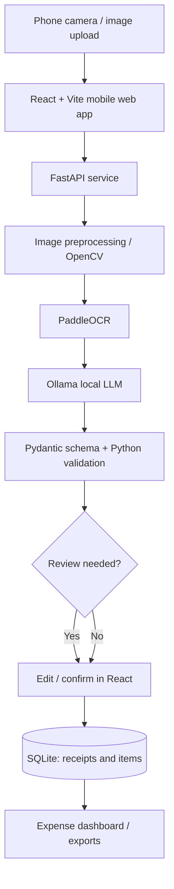

# ReceiptIQ 🧾

**Privacy-first receipt scanning and personal expense intelligence.**

> **Status:** Phase 0 — project planning and repository setup. No receipt scanning or AI extraction is implemented yet.

ReceiptIQ is a mobile-friendly web app that lets you photograph paper receipts using your phone, extract purchase details into structured data, review and correct the results, and track household spending over time.

## The problem

Paper receipts contain useful transaction data, but manually recording individual products, discounts, and totals is slow. Their layouts vary widely, receipt text is often abbreviated, and OCR mistakes can introduce inaccurate expense records.

## Planned solution

1. **Capture:** Take a receipt photo from a phone or upload an image.
2. **Recognize:** Preprocess the image and extract text with PaddleOCR.
3. **Structure:** Use a local Ollama language model to transform text into schema-constrained receipt data.
4. **Validate:** Check field types, required fields, totals, discounts, and arithmetic with deterministic Python logic.
5. **Review:** Show uncertain or inconsistent fields for manual correction before saving.
6. **Store and explore:** Save confirmed receipts in SQLite and visualize spending in a React dashboard.

### System architecture (planned)



All OCR, LLM, and database processing is planned to run **locally on the user's Mac**. The phone will access the web app over the local network; the Mac must be powered on and running the backend. Remote access is **out of scope** for the MVP.

## Planned technology stack

| Layer | Technology | Purpose |
| --- | --- | --- |
| Mobile UI | React, Vite | Camera/upload, review, spending dashboard |
| API | Python, FastAPI | Uploads, pipeline orchestration, receipt CRUD |
| Image processing | Pillow / OpenCV | Rotation, contrast, crop as needed |
| OCR | PaddleOCR | Text recognition and positions |
| LLM | Ollama with a locally tested model | Structured field and line-item extraction |
| Data contracts | Pydantic | Enforce schemas and normalize nullable fields |
| Validation | Python `Decimal` | Financial arithmetic and anomaly flags |
| Database | SQLite | Persist confirmed receipts and items |
| Analytics | Pandas, Recharts | Spending summaries and visualizations |
| Tests | Pytest | Unit and extraction regression tests |

*The exact OCR/model versions will be pinned after compatibility and accuracy testing on Apple Silicon.*

## MVP scope

- Photograph a receipt on a phone; upload an image.
- Extract merchant, date, currency, line items, quantities, prices, discounts, tax, and total **when present**.
- Preserve original OCR text and allow `null` for unknown values; **never fill missing values by guessing**.
- Flag mismatched totals or uncertain data for review.
- Edit and confirm extracted fields before saving to SQLite.
- View a receipt history list and basic category/month spending totals.

### Not in the first version

- Automatic bank integrations, financial account access, or payment handling.
- Multi-user accounts or syncing household members.
- Agent orchestration or autonomous transactions.
- Cloud hosting or automatic remote phone access.

## Repository layout

```text
receipt-iq/
├── backend/               # FastAPI, OCR, extraction, validation, tests (future code)
│   ├── app/
│   │   ├── api/
│   │   ├── core/
│   │   ├── models/
│   │   └── services/
│   │       ├── ocr/
│   │       ├── extraction/
│   │       ├── validation/
│   │       └── normalization/
│   └── tests/
├── frontend/              # React + Vite app (future code)
├── docs/
│   ├── architecture.md
│   └── development-roadmap.md
├── .gitignore
└── README.md
```

## Development plan

See [architecture details](docs/architecture.md) and [milestones and acceptance criteria](docs/development-roadmap.md).

The **first implementation milestone** is a local command/API that takes one receipt image and returns OCR text plus structured, *validated or review-flagged* JSON. We will test with synthetic or permission-cleared images before processing real household receipts.

## Data privacy and safety

- **Do not commit actual receipts, bank/card details, SQLite databases, logs containing personal information, or model credentials.**
- `.gitignore` excludes common local storage and secret paths, but review `git status` before every commit: `.gitignore` cannot prevent deliberately staged files or information pasted into other tracked files.
- Prefer synthetic samples for public demos and tests; redact receipt identifiers and payment details in any screenshots.
- Add request-size limits and file-type checks when implementing uploads.
- For the phone camera, use a mobile-friendly upload control initially; advanced live camera capture may require HTTPS and browser permissions.

## How to contribute during development

Work in small increments. Suggested branch names: `feature/ocr-pipeline`, `feature/structured-extraction`, `feature/receipt-review`. Commit tests and documentation alongside new behavior.

## License

No license has been selected yet. A license can be added when ready to publish reuse terms.
